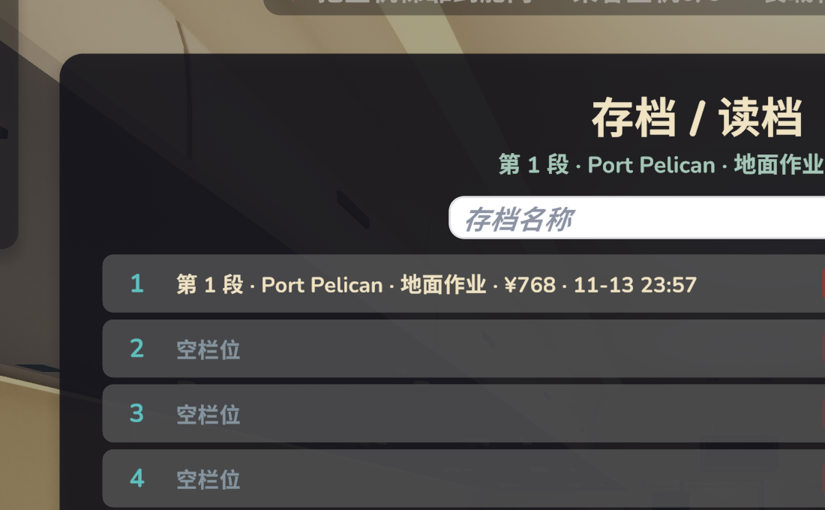

# Mayday Airways 存档 MOD（MaydaySave）

给《Mayday Airways DEMO》加一套**手动存档 / 读档**系统：游戏里随时按 **F8**（或点右下角「存档」按钮）
打开界面，**10 个存档栏位**，想存哪个存哪个、想读哪个读哪个。

- 当前版本：**v5.0.1**
- 运行方式：BepInEx 6（IL2CPP）插件，**不改游戏本体**，删掉即还原
- 用途：和朋友联机时保存进度、试错、防坠机重开

> 已按需求去掉：自动存档、读自动档、读最新档。只有你主动操作才会存/读。

---

## 截图

| 存档界面 | 栏位操作 |
|---|---|
|  |  |

---

## 一、安装

1. 解压压缩包，把里面的东西**整个覆盖**到游戏根目录（和 `MaydayAirways.exe` 同级）：
   ```
   Mayday Airways Demo\
   ├─ winhttp.dll              （BepInEx 加载器）
   ├─ doorstop_config.ini
   ├─ dotnet\                  （IL2CPP 运行时）
   └─ BepInEx\
        ├─ core\               （框架本体）
        ├─ unity-libs\         （Unity 适配库）
        ├─ config\             （配置）
        └─ plugins\MaydaySave.dll   ★ 本 MOD
   ```
2. **首次启动慢一点**（生成适配层，约 1–3 分钟），之后秒开。
3. 右下角出现「存档」按钮 = 安装成功。
4. 卸载：运行根目录的 `卸载.ps1`，或直接删掉上面这些文件。

---

## 二、使用

- 打开界面：按 **F8**，或点右下角「存档」按钮
- 关闭界面：再按 **F8**、按 **ESC**、点「关闭」按钮
- 每个栏位四个操作：**删除 / 改名 / 保存 / 读取**（删除有二次确认）
- 改名：点「改名」弹小窗输入，留空 = 清除名称
- **只在飞机起飞前可用**：进入飞行阶段后保存/读取都会变灰

界面底部两行说明：

```
只能在飞机起飞前存档；读档会回到该段的登机阶段。
读档会清空所有行李，并将乘客设为「无行李」状态（可在配置文件里关闭）
```

---

## 三、存了什么

| 类别 | 内容 |
|---|---|
| **一局进度** | 种子、第几段、金钱/负债/评级、当前与目的机场、一天中的时刻、天气、累计乘客/收入、已购升级、阶段 |
| **飞机** | 位置、朝向、油门、发动机开关、起落架、**各部位损伤**、**喷漆涂装**、机身骨架、厕所、咖啡机、烤箱等系统状态、**客舱座椅排（扩容/头等舱）** |
| **燃油** | 左右**主油箱**油量、备用油箱、油泵开关、交输阀 |
| **地面载具** | 加油车、行李拖车、客梯车、行李转盘/装载车等，位置 + **谁拖着谁**的挂接关系 |
| **物品** | 飞机上/货舱/行李框/地面所有物品的种类、数量、状态、颜色(Tint)、位置、朝向 |
| **背包** | 按 SteamID 分别记录每人的物品与当前选中格 |
| **玩家** | 位置、朝向、死活；联机时每个人都会被拉回存档位置 |
| **乘客** | 人数、位置、朝向、座位号、存活状态（读档后用游戏接口驱动到正确状态） |
| **行李** | 见下方「行李的三种处理方式」 |

---

## 四、读档会发生什么

读档会**按存档时的阶段分流**，不是一律回到登机：

| 存档阶段 | 读档结果 |
|---|---|
| `PreShift` 出发准备 | 回到出发准备，重新生成候选航班 |
| `Arrived` / `Deplaning` / `Turnaround` | **不重放接单**，直接回到该阶段（不会自动接新单） |
| `Boarding` 地面作业 | 重放该段航程，回到**该段登机阶段** |

补充说明：

- **种子会还原**（`GameState.RunSeed`），所以天气、侧风、光照、鸟情这些"由种子推导"的东西是一致的；
- **候选目的地**没有逐字段保存，是按当前世界状态（机场、距离、座位、已访问）重新筛的，
  通常和存档时一致，边缘情况可能变；
- **阵风/颠簸**用的是游戏的全局随机数，**每次都不一样**，这部分不受存档控制；
- 物品、背包、设备状态会在世界重建完成后再套用一次，尽量贴近存档瞬间。

---

## 五、行李的三种处理方式

游戏里行李的所有权归"乘客系统 + 传送带"，外部强行重建会产出"看得见拿不动"的幽灵行李，
所以这里提供三种模式（配置文件里切换，改完重启游戏生效）：

| 配置 | 效果 |
|---|---|
| `BagFreeMode=true` + `PartialBags=false`（**默认**） | 读档**清空所有行李**，乘客设为「无行李」→ 完全跳过行李环节，不扣钱 |
| `BagFreeMode=true` + `PartialBags=true` | 先清空，再**随机 1~N 位乘客**保留行李需求，行李补发到玩家脚边/背包 |
| `BagFreeMode=false` + `BagFallback=false` | **完全不干预行李**（最保守）：保留现状，但可能有幽灵行李、乘客可能因没行李超时 |

> 说明：游戏里的"行李总数"是实时统计"世界里存在的行李件数 − 已交付件数"，
> 不存在"生成了但不计数"这种状态。所以只能二选一：保流程（清空/补发）或保计数（不干预）。

---

## 六、联机

- **只有房主能存/读**，朋友不用装 MOD
- 最稳的做法：**房主先进房、读档、状态摆好，再叫朋友进来**
- 朋友已在房间里时房主读档：大家的玩家位置会被一起拉回存档那一刻
- 中途有人掉线，让他重连即可，存档在房主那边

---

## 七、文件与配置

```
BepInEx\MaydaySave\saves\slot1.txt ... slot10.txt    纯文本，可直接看/备份/互传
BepInEx\config\com.dsh.maydaysave.cfg                配置
BepInEx\LogOutput.log                                运行日志
```

配置文件：

```ini
[General]
## 存读档时在游戏内弹出提示
Notify = true

## 读档时清空全部行李并把乘客设为无行李，跳过行李搬运环节
BagFreeMode = true

## BagFreeMode 开启时：随机挑几位乘客保留行李需求，并把行李发到玩家脚边
PartialBags = false

## BagFreeMode 关闭时：行李不足就补发可交互行李（会占用行李总数）
BagFallback = true
```

更详细的配置说明见压缩包里的 **`配置说明.txt`**。

---

## 八、已知问题

1. **行李无法精确复原**——按上面三种模式处理，取舍已在界面与文档中说明；
2. **加油过程中存档**，金额偶尔有偏差 → 建议加完油再存；
3. **乘客情绪与个别交互状态**只能还原一部分；
4. **联机时非房主的物品**极端情况下可能重复一次 → 丢掉一件即可；
5. **候选目的地**未逐字段保存，通常一致但非保证；
6. **阵风 / 颠簸 / 随机事件**每次不同（游戏用全局随机数）。

---

## 九、版本历史

| 版本 | 主要改动 |
|---|---|
| v5.0.1 | 客舱**座椅扩容**随存档恢复（修 `rowMask` 导致"已装但不生成模型"） |
| v5.0.0 | 界面底部加行李说明；独立《配置说明.txt》 |
| v4.9.0 | 回退随机行李（`PartialBags=false`），保留无行李模式 |
| v4.8.0 | 无行李模式 + 随机部分行李（脚边/背包补发） |
| v4.7.0 | **无行李模式**：清空行李 + 乘客 `BagNetId=0`，跳过行李环节 |
| v4.6.0 | 行李兜底加开关，说明"为什么不计数做不到" |
| v4.5.0 | 兜底改为"保证可交互件数"，不足的补进背包 |
| v4.4.0 | **主油箱油量** + 行李兜底补发 |
| v4.3.0 | 按航段阶段分流（修"自动接单"）；乘客不再走通用快照（修幽灵乘客） |
| v4.2.0 | 行李系统全量回退（修传送带卡死） |
| v4.1.0 | 乘客位置随存档恢复（修"读档跑回机场"卡关） |
| v4.0.0 | 只修剪 `act=0` 的幽灵行李，不再重建 |
| v3.9.0 | 清孤儿 + 把存档行李重新生成回去 |
| v3.8.0 | 定位幽灵行李根因（旧世界遗留孤儿） |
| v3.5–3.7 | 传送带行李不碰 / 读档清场实验 |
| v3.4.0 | 行李按乘客归属 + 位置复位 |
| v3.3.0 | 物品 **Tint 颜色**（喷漆罐颜色） |
| v3.2.0 | 读档末尾补写背包状态（修手持喷漆变色） |
| v3.1.0 | 喷漆改存"显示色"，按真实颜色重喷 |
| v3.0.0 | 飞机位置改用世界坐标（修"位置不变只有朝向变"） |
| v2.9.0 | 喷漆走 `ServerPaintTick`；行李交给乘客系统；背包副本 |
| v2.8.0 | 坐标系修正（飞机/玩家/下海）；手持物品；拖挂；行李 |
| v2.7.0 | 相对坐标（下海 bug）、重复物品、喷漆诊断 |
| v2.6.0 | 改用游戏自己的传送接口（`ServerTeleport` / `DevTeleport`） |
| v2.5.0 | 改名弹窗、幽灵行李清理、手持物品、备用油箱、飞机父链 |
| v2.4.0 | 位置、喷漆/破洞、联机传送、行李幽灵、每档命名 |
| v2.3.0 | 通用网络对象快照（飞机受损/位置/车辆/乘客/玩家） |
| v2.2.0 | 槽位还原 / 背包顺序 / 删除存档 |
| v2.1.0–2.1.1 | 读档改"对账式恢复"；背包 / 缺失物品 / 隐藏控制台 |
| v2.0.2 | 早期修复 |

---

## 十、排错

遇到问题请把 `BepInEx\LogOutput.log` 里以 `[save]` / `[load]` 开头的行发出来，例如：

```
[save] slot3: 物品=41 设备=59
[load] snapshot applied=53 missing=0 props=328
[load] plane sim -> (-9122.00, 4.00, 512.00) hdg=45.0
[load] players placed 1/1
[load] pax placed 6/6 skipped=0 reboard=0
[load] seat rows verify: ok=4 retried=0 stillMissing=0 (saved 4)
[load] bag-free mode: destroyed=5 paxDetached=6
[load] items: live=41 saved=36 applied=36 moved=0 destroyed=0 spawned=0
```

这些数字能直接定位是哪一步没对上。

---

## 十一、相关交付物

- `安装说明.txt`：安装 / 卸载 / 快速上手
- `配置说明.txt`：四个开关的详细说明与四种玩法组合
- 介绍视频（另附）：4 分 37 秒，含全部功能与已知问题的口播
